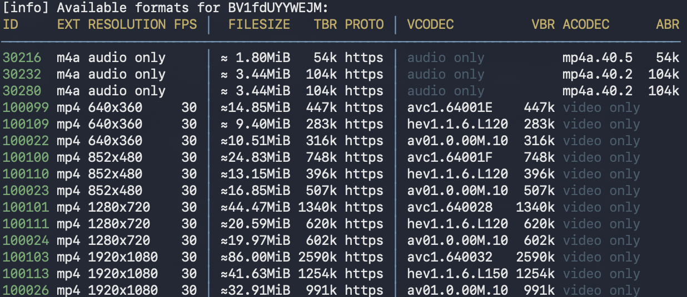

- `yt-dlp -U` 更新yt-dlp  
- `yt-dlp -F "视频链接"` 查詢視頻所有畫質與音頻編號
 - `yt-dlp -F "https://www.bilibili.com/video/BV1fdUYYWEJM"`  

- `yt-dlp -F "bv*+ba/b" "视频链接"` 下載最佳畫質策略  
- `yt-dlp -o "~/Downloads/%(title)s.%(ext)s" "视频链接"` 下載到指定位置  
- `yt-dlp -f 137+140 "视频链接"` 下載列出的視頻編號137與音頻編號140並合併  
- `yt-dlp -x --audio-format mp3 "视频链接"` 提取音頻並轉化爲mp3格式  
- `--cookies-from-browser chrome` 讀取瀏覽器cookie

